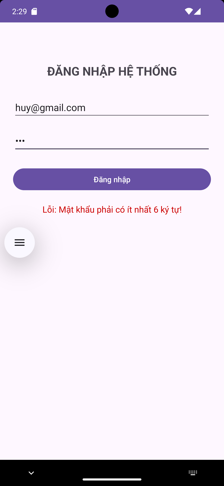
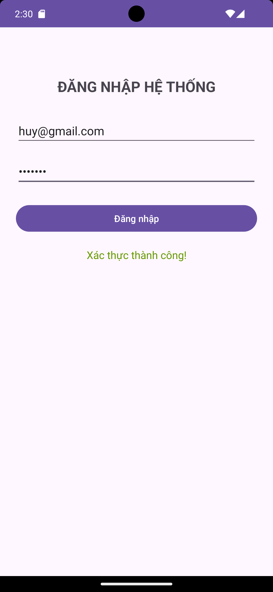
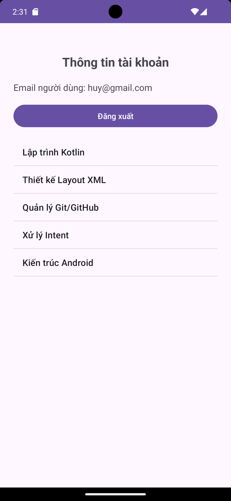
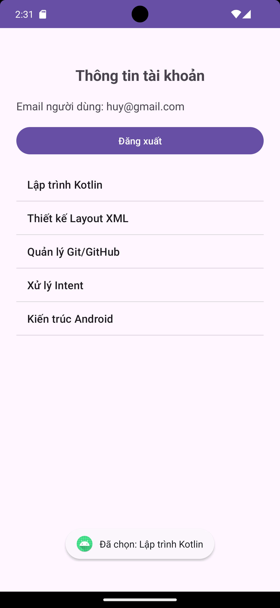

# Kiểm Tra Lập Trình Ứng Dụng Di Động

**Mã số sinh viên (MSSV):** 2474802015199  
**Tên Repository / Project:** `KiemTra_LapTrinhUngDungDiDong_2474802015199`

---

## Tổng quan bài kiểm tra
- **Câu 1 (3.5đ):** Giao diện đăng nhập (`LoginActivity`), xác thực dữ liệu (Email hợp lệ, mật khẩu >= 6 ký tự, không bỏ trống) bằng `findViewById`.
- **Câu 2 (3.5đ):** Điều hướng Explicit Intent từ `LoginActivity` sang `ProfileActivity`, truyền dữ liệu qua `putExtra`, xử lý đăng xuất (`finish()`).
- **Câu 3 (3.0đ):** Hiển thị danh sách 5 môn học bằng `ListView` và `ArrayAdapter` trong `ProfileActivity`, bắt sự kiện click hiển thị `Toast`.

---

## Cấu trúc Nhánh (Git Branches)
- `cau-1`: Mã nguồn hoàn chỉnh Câu 1.
- `cau-2`: Mã nguồn Câu 2 (kế thừa từ `cau-1`).
- `cau-3`: Mã nguồn hoàn chỉnh Câu 3 (kế thừa từ `cau-2`).

---

## Minh chứng hình ảnh thực tế (`screenshots/`)

### 1. Câu 1: Màn hình Đăng nhập & Xác thực dữ liệu
- **Lỗi dữ liệu không hợp lệ:**  
  

- **Xác thực thành công:**  
  

---

### 2. Câu 2: Điều hướng Intent & ProfileActivity
- **Màn hình Profile hiển thị Email người dùng:**  
  

---

### 3. Câu 3: Màn hình Danh sách ListView & Thông báo Toast
- **Hiển thị danh sách môn học:**  
  

- **Thông báo Toast khi chọn môn học:**  
  
